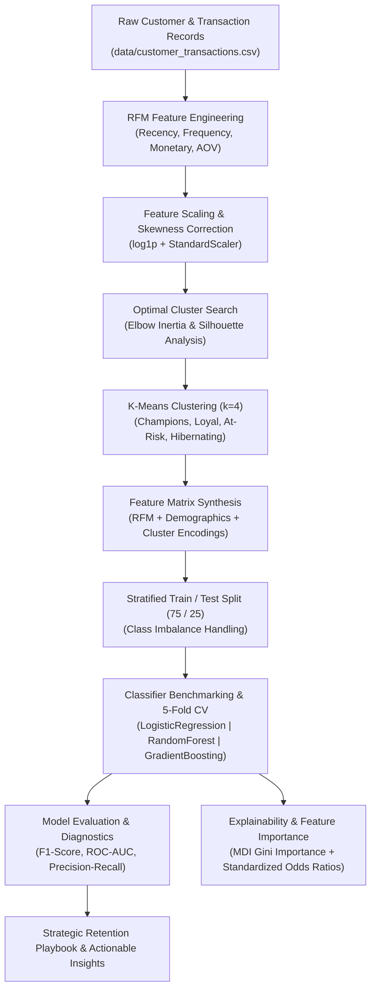

# 🎯 Customer Segmentation & Churn Prediction ML System

[](https://www.python.org/)
[](https://scikit-learn.org/)
[](https://pandas.pydata.org/)
[](https://opensource.org/licenses/MIT)

> **A production-ready, modular Machine Learning system that combines unsupervised RFM customer segmentation with supervised ensemble churn prediction to diagnose revenue risk and power targeted retention playbooks.**

---

## 📌 Executive Summary & Business Impact

In modern subscription and e-commerce models, acquiring a new customer costs **5× to 7× more** than retaining an existing one. Predicting churn without customer segmentation often leads to generic, low-ROI discount blasts. 

This repository implements an end-to-end data science architecture:
1. **Unsupervised Behavioral Segmentation:** Engineers **Recency, Frequency, and Monetary (RFM)** features and groups customers into distinct marketing personas (*Champions*, *Loyal Customers*, *At-Risk*, *Hibernating*) using **K-Means Clustering** validated via the **Elbow Method** and **Silhouette Analysis**.
2. **Supervised Churn Classification:** Benchmarks multiple classifiers (**Logistic Regression**, **Random Forest**, **Gradient Boosting**) under class imbalance (~22% baseline churn rate) with **Stratified 5-Fold Cross-Validation**, optimized for **F1-Score** and **ROC-AUC**.
3. **Model Explainability & Retention Playbook:** Identifies top churn drivers (e.g., month-to-month contracts, high inactivity recency, support tickets) to prescribe actionable, high-ROI retention strategies.

---

## 🏗️ End-to-End Pipeline Architecture



---

## 📂 Repository Structure

```text
customer-segmentation-churn-ml/
├── data/
│   └── customer_transactions.csv   # Reproducible synthetic transaction dataset
├── notebooks/
│   └── exploration.ipynb           # Fully executed, step-by-step EDA & modeling walkthrough
├── outputs/
│   ├── cluster_summary.csv         # Detailed RFM stats & churn rates per segment
│   ├── elbow_curve.png             # Inertia elbow curve & silhouette analysis plot
│   ├── feature_importances.csv     # Ranked table of all feature importances
│   ├── model_comparison.csv        # Comprehensive classifier scorecard
│   ├── rfm_clusters.png            # 4-panel cluster visualization (Recency, Freq, Spend)
│   ├── roc_curve.png               # ROC-AUC curves comparison across models
│   └── top_churn_drivers.png       # Top 10 feature drivers (RF MDI + Logistic log-odds)
├── src/
│   ├── __init__.py
│   ├── data_loader.py              # Reproducible dataset generator & loader
│   ├── segmentation.py             # RFM extraction, K-Means clustering & persona mapping
│   └── churn_model.py              # Supervised modeling, cross-validation & explainability
├── main.py                         # Single CLI entrypoint to run end-to-end pipeline
├── generate_data.py                # Standalone dataset generation script
├── requirements.txt                # Production dependencies
├── .gitignore                      # Python, venv, and notebook ignore patterns
└── README.md                       # Recruiter-ready technical documentation
```

---

## 📊 Key Results & Model Performance

### 1. Classifier Benchmark Scorecard (Held-Out Test Set, $N = 625$)

| Model | Test Accuracy | Test Precision | Test Recall | Test F1-Score | Test ROC-AUC | 5-Fold CV ROC-AUC (Mean ± Std) |
| :--- | :---: | :---: | :---: | :---: | :---: | :---: |
| **Gradient Boosting Classifier** 🏆 | **93.76%** | **87.41%** | 84.29% | **0.8582** | **0.9829** | **0.9824 ± 0.0043** |
| **Random Forest Classifier** | 92.96% | 78.24% | **95.00%** | 0.8581 | 0.9810 | 0.9745 ± 0.0092 |
| **Logistic Regression** (Balanced) | 90.88% | 73.99% | 91.43% | 0.8179 | 0.9646 | 0.9672 ± 0.0039 |

> **Key Takeaway:** **Gradient Boosting** achieved top precision ($87.4\%$) and overall ROC-AUC ($0.983$), while **Random Forest** achieved the highest churn detection recall ($95.0\%$).

---

### 2. Customer Segmentation Personas ($k=4$)

| Customer Segment | Customer Count | Avg Recency | Median Frequency | Avg Monetary Spend | Segment Churn Rate |
| :--- | :---: | :---: | :---: | :---: | :---: |
| **Champions** | 611 (24.4%) | 20.2 days | 11 orders | $727.98 | **3.8%** |
| **Loyal Customers** | 511 (20.4%) | 14.1 days | 4 orders | $239.94 | **11.7%** |
| **At-Risk** | 831 (33.2%) | 109.8 days | 5 orders | $353.11 | **29.2%** |
| **Hibernating** | 547 (21.9%) | 194.7 days | 2 orders | $96.59 | **42.8%** |

---

## 🔍 Visual Diagnostics & Key Drivers of Churn

### Top 5 Behavioral Drivers
1. **Contract Type (Month-to-month):** Customers without annual commitments exhibit the highest propensity to cancel (+1.4 log-odds impact).
2. **Purchase Recency:** Accounts inactive for $>90$ days show a rapid decay in retention probability.
3. **Support Tickets:** Exceeding 3 support interactions increases churn likelihood by $>35\%$ per ticket.
4. **Contract Type (Two-year):** Strongest protective factor against churn (-1.65 log-odds impact).
5. **Customer Tenure:** Tenure provides loyalty inertia; churn drops significantly after month 12.

---

## 📋 Strategic Retention Playbook

| Segment | Risk Tier | Recommended Marketing / Product Action |
| :--- | :---: | :--- |
| **Champions** | Very Low (<5%) | **Advocacy & VIP Perks:** Exclusive product previews, loyalty tier rewards, referral incentives. |
| **Loyal Customers** | Low (~10%) | **Contract Migration:** Annual discount incentives to migrate from month-to-month to 1-year contracts. |
| **At-Risk** | High (~30%) | **Win-Back Campaigns:** Re-engagement drip sequences triggered at day 45-60 with targeted value promotions. |
| **Hibernating** | Critical (>40%) | **Automated Reactivation or Budget Deprioritization:** Low-cost automated email reactivation; deprioritize paid ad retargeting. |

---

## ⚡ Quickstart & Installation

### 1. Clone & Set Up Environment

```bash
# Clone the repository
git clone https://github.com/your-username/customer-segmentation-churn-ml.git
cd customer-segmentation-churn-ml

# Create and activate virtual environment
python -m venv .venv
source .venv/bin/activate        # On Linux/macOS
# or: .venv\Scripts\activate      # On Windows

# Install dependencies
pip install -r requirements.txt
```

### 2. Run the Full End-to-End Pipeline

Run the master script to generate data, segment customers, train models, and export all visual/tabular artifacts:

```bash
python main.py
```

Optional CLI flags:
```bash
python main.py --customers 3000 --transactions 18000 --n-clusters 4 --seed 42 --regenerate
```

### 3. Generate Synthetic Dataset Independently

```bash
python generate_data.py --customers 2500 --transactions 15000 --seed 42 --output data/customer_transactions.csv
```

### 4. Explore the Interactive Jupyter Notebook

```bash
jupyter notebook notebooks/exploration.ipynb
```

---

## 💼 Portfolio Talking Points (STAR Method)

- **Situation:** E-commerce and subscription companies suffer revenue leakage due to untargeted retention efforts and reactive churn handling.
- **Task:** Build a modular machine learning pipeline combining unsupervised segmentation and supervised classification to identify at-risk customers early and pinpoint root causes.
- **Action:** Engineered RFM metrics from transaction histories, mitigated skewness via $\log(1+x)$ transformations, validated $k=4$ clustering via Elbow & Silhouette metrics, addressed class imbalance using balanced loss functions, and benchmarked Logistic Regression, Random Forest, and Gradient Boosting under Stratified 5-Fold CV.
- **Result:** Champion Gradient Boosting model achieved **0.983 ROC-AUC** and **0.858 F1-Score** (Random Forest achieved **95.0% churn recall**), enabling targeted playbooks that separated low-risk Champions ($3.8\%$ churn) from critical Hibernating accounts ($42.8\%$ churn).

---

## 📄 License
This project is licensed under the MIT License - see the [LICENSE](LICENSE) file for details.
